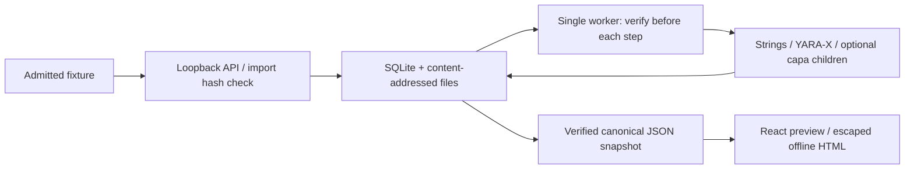

# Bytasm

Bytasm is a local app for inspecting PE and ELF binaries without running them.
Import a file, browse its headers, sections, imports and strings, run the
bundled YARA-X rules or the pinned capa subset, and preview JSON and standalone
HTML reports with provenance and evidence.

The backend uses FastAPI, SQLite and LIEF. The UI uses React and TypeScript.
A separate worker extracts strings and runs YARA-X and optional capa. The project is still in early development. It also supports version comparison
and analyst annotations with citations and revision history.

## Before you start

Use the committed fixtures in `fixtures/bin/`. By default, Bytasm checks each
file's SHA-256 against `fixtures/MANIFEST.sha256` before parsing it. Files
outside that list are refused. Native Linux also supports an optional
`self_built` mode for programs compiled from source you wrote.

Do not import downloaded, third-party or suspicious binaries, including malware.
The analysis processes have time and resource limits, but no sandbox: a parser
exploit could access your files and network. Docker does not provide the missing
analysis boundary. Native macOS runs are fixtures-only because the parser's
memory limit cannot be enforced there.

Bytasm has no accounts or authentication. Keep it on localhost. A rule match
shows that a pattern occurred; it does not establish whether a file is malicious
or safe. The authorisation statement you enter on import records your claim of
permission, without verifying it. See [SECURITY.md](SECURITY.md) for the limits.

## Run locally

You need [uv](https://docs.astral.sh/uv/), Python 3.12 or later (uv can install
it), Node.js 26 and npm. Docker with Compose v2 is needed for the container setup.

Install the locked dependencies into `backend/.venv` and `frontend/node_modules`:

```sh
make install
```

Start the API and worker with Docker:

```sh
make compose-up
```

Or run them natively:

```sh
make serve
```

Both build the UI and serve it at http://127.0.0.1:8000/. With Docker, use
`make compose-down` to stop. With `make serve`, press Ctrl+C.

1. Create a project.
2. Import `fixtures/bin/hello_v1-x86_64.exe` and enter an authorisation statement.
3. Browse the metadata, sections, imports and exports.
4. Choose **Run pattern matching…** to extract strings and scan with YARA-X.
5. Open a finding to inspect its offsets, matched bytes and rule text.
6. In **Reports**, choose **Preview new report**, then download JSON or standalone HTML.
7. For capa, import `fixtures/bin/capa_environment-x86_64.exe`, select **Full static
   review**, and inspect its environment-query observation and function address.
8. Add an analyst note or cited conclusion; compare two versions of the same
   sample. Comparison reports warn that changed strings and analyst text may be shared.

This working tree targets **v0.4.0** (schema 4), pending owner review. **Tools**
shows installed versions, availability, adapters, rules hashes and profile limits.
Quick static review remains the default. Full adds capa 10.0.0 with two upstream
Apache-2.0 rules, native PE x86/x64 only and no library signatures. Other formats
keep Quick results and explicitly show partial analysis. Function addresses from
capa are not file offsets. No arbitrary commands, plugins or custom rules are exposed.
See [v0.4 scope and verified limits](docs/milestones/v0.4-deeper-analysis-sharing.md)
and [dependency notices](THIRD_PARTY_NOTICES.md), including an unresolved transitive
license packaging issue before redistributing the image.



The **Rules** page shows and validates the bundled rules. They are read-only
in the app; editing them requires a code change.

### Data and configuration

Native runs store SQLite, blobs, analysis outputs and reports in `./data/`,
which Git ignores. Docker uses the `bytasm-data` volume. Stopping either setup
preserves its data; `docker compose down --volumes` deletes the Docker data.

| Variable | Default | Meaning |
|---|---|---|
| `BYTASM_DATA_DIR` | `<repo>/data` | Database and stored files |
| `BYTASM_HOST` | `127.0.0.1` | Native loopback address |
| `BYTASM_PORT` | `8000` | API port |
| `BYTASM_INPUT_POLICY` | `fixtures` | `fixtures` or `self_built` |

Configuration is read at startup. `self_built` works only on native Linux,
is off by default, and cannot be enabled through the API or UI. When enabled,
the UI shows a banner and reports record `self_built_optin`.

The Docker image sets `BYTASM_CONTAINER=1` and refuses `self_built`. Its API
listens on the container interface; Docker publishes it on host loopback only.
See [ADR-0002](docs/adr/0002-v0.1-implementation-choices.md).

## Analysis and reports

Imports read LIEF metadata once. Analysis runs then execute two steps:

- Strings: printable ASCII and UTF-16LE sequences of at least six characters,
  with file offsets. At most 5,000 are stored, with each value capped at 256
  characters. UTF-16LE extraction covers ASCII characters only.
- YARA-X: five bundled rules, with the exact rule snapshot retained for each run.
  Reported byte ranges are checked against the stored file.

Runs can succeed, fail, finish partially or be cancelled. Finished steps keep
their results if a later step fails or is cancelled. The run page shows each
step, a technical log, findings and validated raw JSON downloads. The Strings
tab supports search, encoding filters and paging.

Reports use schema version 4 and include metadata, provenance, string counts,
findings with evidence and analyst annotations. Single-version reports omit
string values; comparison reports can include changed strings. Exports re-check stored
file hashes and are reproducible apart from `generated_at`.
See the [report format](docs/report-format.md) and
[v0.2 milestone](docs/milestones/v0.2-pattern-matching.md) for details.

Project creation also records a `project.created` audit event in the same
transaction, with a local actor and an empty payload. The project page shows a
read-only activity history of imports, analysis runs and analyst annotations.

### CLI and demo

Inspect a manifest fixture from the terminal:

```sh
uv --directory backend run bytasm inspect ../fixtures/bin/hello_v1-aarch64.elf
```

The CLI prints deterministic JSON. Exit codes are 0 for success, 1 for an
operational error and 2 for refused input or parsing failure.

Run the scripted import, analysis and report demo with temporary data:

```sh
make demo
```

To use a running instance instead:

```sh
make demo DEMO_ARGS="--url http://127.0.0.1:8000"
```

See [docs/demo.md](docs/demo.md) for the walkthrough and cleanup.

## Compare and annotate

Import two versions into the same sample, then choose **Compare versions**.
The comparison shows additions, removals and changes by category. Missing or
incompatible analyses are explained instead of shown as zero results.

On a version or inside a finding's evidence panel, choose **Add note / View
annotations**. Notes and interpretations are plain text; conclusions also need
confidence and a finding or evidence citation. **Revise** keeps the original
text in revision history. The project activity records creation and revision
without copying the annotation text. Export a comparison from its own page.

## Development

```sh
make check             # Python and frontend lint, types and unit/integration tests
make e2e               # Playwright against local API and worker processes
make audit             # pip-audit and npm audit
make compose-check     # validate container settings without starting containers
make check-linux       # backend checks in a Linux container
make verify-fixtures   # compare fixture bytes with the manifest
make schemas           # regenerate the report schema
```

If Playwright cannot find Chromium, run
`npx --prefix frontend playwright install chromium`.
CI checks Python 3.12 and 3.14, the frontend, end-to-end behaviour, dependencies
and the Compose setup.

| Path | Contents |
|---|---|
| `backend/src/bytasm/` | API, worker, adapters, persistence and reports |
| `backend/tests/` | Unit and integration tests |
| `frontend/` | React UI and Playwright tests |
| `rules/yara/` | Bundled rules |
| `fixtures/` | Self-authored C sources, binaries and hash manifest |
| `schemas/` | JSON report schema |
| `docs/` | Blueprint, decisions, milestones and report format |

Fixture builds are documented in [fixtures/BUILD_INFO.txt](fixtures/BUILD_INFO.txt).
PE and ELF parsing uses LIEF; test coverage is limited to these fixtures and
test-generated inputs.

## Troubleshooting

| Problem | What to check |
|---|---|
| UI is not built | Run `make web-build`, or start with `make serve` / `make compose-up`. |
| Port 8000 is busy | Stop the other process, or use `BYTASM_PORT=8001 make serve` natively. |
| Host is refused | Open `127.0.0.1` or `localhost`, using the configured port. |
| Input is refused | Use a manifest fixture; run `make verify-fixtures` to check it. |
| HTTP 503 | An import or rule validation is already using the parser slot. Retry when it finishes. |
| Run stays queued | Start the worker with `make worker`; use the same data directory as the API. |
| Worker lock is held | Only one worker can use a data directory. |
| Error includes a request ID | Look for it in the server output or `docker compose logs api`. |

## Remaining work

ADR-0003 still proposes SQLite for the worker queue and needs owner review.
The UI version still reads `0.0.1`; its strings counter needs to distinguish
unanalysed input from zero results. The UPX-style rule needs a positive test.
The v0.3 comparison and annotation workflows are described in the
[milestone record](docs/milestones/v0.3-compare-annotate.md). See the
[blueprint](docs/PROJECT_BLUEPRINT.md) for the wider scope.

## Licence

A project licence has not been chosen. Dependency licences are separate:
[LIEF](https://lief.re) uses Apache-2.0 and
[YARA-X](https://virustotal.github.io/yara-x/) uses BSD-3-Clause.
The lock files list the remaining dependencies and versions.


## Evidence-led review after PR6

Analysis results now connect reviewed, deterministic explanations to exact
findings, rule/tool versions, evidence locations and source runs. Possible
interpretations are labelled hypotheses, separate from analyst conclusions.
Unknown rule provenance receives no specific interpretation. No AI or risk
score is used. Reports use their canonical stored summary and snapshot records.

On a version, the section map compares declared raw sizes and entropy on its
true 0–8 measurement scale, with the complete source table below. The strings
explorer supports stable sorting, heuristic prefix categories, paging and exact
raw-section references where unambiguous. Path-like values are hidden until
explicitly revealed; original values remain in the local API. No string is an
automatic link or a behavior claim. Run links keep the selected run's strings.

The Compose worker is offline (`network_mode: none`); the API's import parser
and native processes retain their existing network/filesystem risks. The input
policy and unresolved dependency redistribution issue remain unchanged.
See the [post-PR6 milestone](docs/milestones/post-pr6-evidence-review.md) for the
implemented scope, follow-ups, source contracts and verification record.

## Optional Ghidra static function review

A caller-installed Ghidra 12.2/JDK 25 provider adds a bounded function review to
admitted fixtures on a configured offline Linux worker. Doctor runs a harmless
Headless/native self-test; configuration metadata alone never means available.
The run page shows a plain-language summary, searchable function inventory,
pseudocode, instructions, exact static-call relationships and separate JSON/HTML
exports. Initial details cover the first 16 internal functions; inventory is
capped at 1024. Explicit selected sets can request additional bounded dossiers.

Nothing is installed or bundled automatically. Native macOS/Windows analysis
and arbitrary-file admission remain unavailable. Follow the
[setup and status guide](docs/ghidra-setup.md), optional Compose example and
[current milestone](docs/milestones/v0.6-function-workbench.md) for precise
limits, verified platforms, deferred scope and residual parser risks.


### Function workbench increment (v0.6, under review)

Ghidra review now retains up to 1024 inventory entries with bounded identity
search, stored facets and exact-run pagination. Select up to eight verified
entries to request a new bounded detail run; matching active/completed requests
reuse their job. Search and stored-evidence browsing never launch Ghidra.
Explore one hop of retained direct static calls with evidence links and a
keyboard-usable table. The overview distinguishes retained details, failed
reconstruction, inventory caps and unknown output. Selected reports retain source
run provenance. No behavior verdict or whole-program coverage is inferred.

Existing fixture/self_built admission, baseline comparisons, annotations and
historical report schemas remain intact. Function bookmarks/notes, Ghidra version
matching, complete xrefs and arbitrary-file intake remain deferred. See the
[current milestone](docs/milestones/v0.6-function-workbench.md) for exact scope,
verification, known risks and follow-up, and the [API](docs/api-v0.5-ghidra.md) for
selection/cursor semantics.
